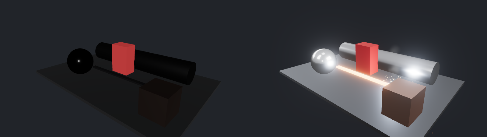
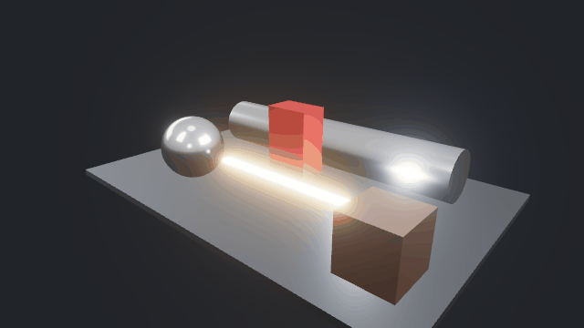

# Realistic visuals in the WebGPU renderer

The renderer in `src/render` can draw more than flat CAD shading. It has six features:

- an HDR target with tone mapping
- image-based lighting for metals
- point lights with flicker
- emissive glow with ramps over time
- bloom
- particle emitters for sparks and smoke

Every feature is plain data (`src/render/effects.h`). Each one is off until it is used, so a scene that sets none of them draws exactly as before and pays nothing for them.





Both images come from `adacpp_render_effects_demo` (see [Trying it](#trying-it)), rendered headless.

Effects that change over time read the renderer's clock, `Renderer::set_time(seconds)`. Every one of them is a pure function of that time, including the particles: nothing is carried over from one frame to the next. A paused, scrubbed or replayed timeline therefore shows the same picture at the same time, and so does a poster rendered headless at that time. `Renderer::animating()` tells an on-demand host whether to keep drawing frames.

## The API

| C++ (`Renderer`) | Browser (`WebRenderer`) | Python (`OffscreenRenderer`) |
| --- | --- | --- |
| `set_post(PostSettings)` | `setPost({...})` | `set_post(json)` |
| `set_environment(EnvironmentDesc)` | `setEnvironment({...})` | `set_environment(json)` |
| `set_environment_hdr(bytes, size)` / `set_environment_map(rgb, w, h)` / `reset_environment_map()` | `setEnvironmentHdr(ptr, len)` / `setEnvironmentMap(ptr, w, h)` / `resetEnvironmentMap()` | `set_environment_hdr(path)` / `reset_environment_map()` |
| `set_time(s)` / `animating()` | `setTime(s)` / `animating()` | `set_time(s)` / `animating()` |
| `add/set/remove_point_light` | `addPointLight()` / `setPointLight(id, {...})` / `removePointLight(id)` | through `apply_effects` |
| `add/set/remove_emissive_ramp` | `addEmissiveRamp()` / `setEmissiveRamp(id, {...})` / `removeEmissiveRamp(id)` | through `apply_effects` |
| `InstanceDesc::emissive`, `::emissive_ramp` | `setInstanceEmissive(instance, r, g, b, ramp)` | |
| `set_segment_emissive(instance, segments, n, ramp)` | `setSegmentEmissive(instance, ptr, n, ramp)` | through `apply_effects` |
| `add/set/remove_emitter` | `addEmitter()` / `setEmitter(id, {...})` / `removeEmitter(id)` | through `apply_effects` |
| `apply_effects(json, objects, transform, look)` / `remove_effects` (`glb_effects.h`) | `applyEffects(json, look)` / `removeEffects(set)` | `apply_effects(json, look)` / `remove_effects(set)` |
| `apply_glb_effects(loaded, options, look)` | `loadGlb(..., {effects: true, effectsLook})` returns `effects` | `load_glb(..., effects=True, effects_look=...)` |

The browser and Python setters take the same keys as the JSON below, so one schema serves every host. A key that is left out keeps its default.

## The schema

A scene carries its effects in the GLB's default scene, under `extras.ada_effects`. The same object can also be handed to `applyEffects` / `apply_effects` on its own.

```json
{
  "version": 1,
  "post": {"hdr": true, "toneMapping": "aces", "exposure": 1.0, "bloom": true,
           "bloomThreshold": 1.0, "bloomKnee": 0.5, "bloomStrength": 0.6, "bloomRadius": 0.7},
  "environment": {"enabled": true, "intensity": 1.0, "rotation": 0.0, "up": [0, 0, 1]},
  "lights": [{"position": [0, 0, 1], "color": [0.8, 0.9, 1], "intensity": 2, "range": 0, "decay": 2,
              "flicker": 0.5, "flickerRate": 15, "seed": 1, "start": 0, "end": 10}],
  "emitters": [{"preset": "sparks", "origin": [0, 0, 0], "direction": [0, 0, 1], "rate": 400, "start": 0, "end": 10}],
  "emissive": [{"targets": ["object-id"], "hotColor": [1, 0.55, 0.15], "hotIntensity": 8,
                "coolColor": [0.6, 0.04, 0], "coolIntensity": 0, "start": 2, "duration": 6, "curve": 0.5}]
}
```

When effects are read from a GLB:

- Positions, directions and gravity are in the GLB's coordinates. They are placed the way the model is placed (`y_up_to_z_up`, `offset`).
- Emissive `targets` name the model's objects (`GlbLoadResult::objects` ids: adapy's object ids, or node indices), and each target takes everything below it too. A batched mesh glows per object, because the glow is set per segment. Targets that name nothing are reported back as `unresolved`.
- `post` and `environment` are applied only when the host asks for them (`effectsLook`). A viewer usually keeps those as its own settings.

All colours are linear RGB.

### `post`: HDR target, tone mapping, bloom

| key | default | meaning |
| --- | --- | --- |
| `hdr` | false (true inside a GLB's `post`) | Draws into an `rgba16float` target in linear light. Values above 1 survive, and transparent surfaces blend in linear light. Off draws straight into the host's target, exactly as before. |
| `toneMapping` | `"aces"` | `"none"` (clamp: the plain look), `"neutral"` (Khronos PBR Neutral: colours kept up to about 0.8, highlights rolled off) or `"aces"` (as three.js' ACESFilmicToneMapping). |
| `exposure` | 1 | Multiplies the scene before tone mapping. |
| `bloom` | false | Needs `hdr`. Anything brighter than the threshold spreads over a chain of half-resolution levels and is added back. |
| `bloomThreshold` | 1 | Linear brightness, after exposure, where bloom starts. |
| `bloomKnee` | 0.5 | A soft knee below the threshold, as a fraction of the threshold. |
| `bloomStrength` | 0.6 | How much of the bloom is added back. |
| `bloomRadius` | 0.7 | 0..1: how much the wider levels weigh against the narrow ones. |

With `hdr` on, the background (`set_background`) still shows as the colour it was given. The target is cleared to the linear value that the tone mapping maps onto that colour.

### `environment`: image-based lighting

| key | default | meaning |
| --- | --- | --- |
| `enabled` | true when given | Lights every lit surface by the environment. |
| `intensity` | 1 | Scales the environment's light. |
| `rotation` | 0 | Turns the environment about `up`, in radians. |
| `up` | `[0, 0, 1]` | Where the environment's zenith points. |

The environment is added to the ambient light and headlight of `set_lighting()`. A scene lit mainly by its environment usually lowers both, for example `set_lighting(0.2, 0.4)`.

How it works:

- **Image.** The default image is a procedural studio: a soft overhead gradient, a darker floor and three softboxes, scaled so that a white diffuse face turned up is lit to 0.75. An equirectangular Radiance `.hdr` replaces it (`set_environment_hdr`), as does any linear RGB float image (`set_environment_map`).
- **Prefiltering.** The image is resampled to 512 x 256 and prefiltered on the GPU by GGX importance sampling into six roughness mips. Its irradiance and a split-sum BRDF table are computed the same way. This happens once per image, the first time the environment is enabled.
- **Shading.** Reflections use the GGX split sum, with three.js' multiple-scattering compensation. Diffuse light comes from the irradiance.

### `lights`: point lights

| key | default | meaning |
| --- | --- | --- |
| `position` | `[0, 0, 0]` | |
| `color` | `[1, 1, 1]` | |
| `intensity` | 1 | In candela, as three.js' PointLight. |
| `range` | 0 | The light falls to zero at this distance; 0 means no cutoff. |
| `decay` | 2 | The light falls off as 1 / distance^decay. |
| `flicker` | 0 | 0..1: the intensity is multiplied by 1 ± flicker times smooth noise. |
| `flickerRate` | 8 | Hz of the fastest variation. |
| `seed` | 0 | Picks the flicker pattern. The same seed and time always give the same flicker. |
| `start`, `end` | always | The light is on only between these times. |
| `enabled` | true | |

At most 16 lights are lit at once: the first ones by id that are on. Flicker is evaluated on the CPU once per frame (`fx::flicker_value`).

### `emissive`: glow and emissive ramps

| key | default | meaning |
| --- | --- | --- |
| `targets` | | Object ids (GLB) that glow. |
| `hotColor`, `hotIntensity` | `[1, 0.55, 0.15]`, 8 | The glow at `start`, and before it. |
| `coolColor`, `coolIntensity` | `[0.6, 0.04, 0]`, 0 | The glow at `start + duration`, and after it. |
| `start`, `duration` | 0, 1 | When the ramp runs, in seconds. A zero duration glows `hot` all the time. |
| `curve` | 1 | The mix weight is ((t − start) / duration)^curve. Below 1 the glow changes fast at first, as a part cooling down does. |

Colour and intensity are interpolated separately and then multiplied (`fx::ramp_value`). The ramp is evaluated on the GPU from the frame's time, so a running ramp costs no upload per frame.

An instance can also glow at a constant level with `InstanceDesc::emissive`, which is linear RGB times strength. The glow is light added after the lighting. Values above 1 need `hdr` to survive, and they bloom.

There are at most 255 ramps. Each instance or segment uses one of them.

### `emitters`: particles

| key | default (`"sparks"`) | meaning |
| --- | --- | --- |
| `preset` | `"sparks"` | `"smoke"` starts from `smoke_emitter()`: slow, growing, fading soft sprites, alpha-blended. |
| `origin`, `velocity` | | Where particles are born. The emitter itself moves at `velocity` from `start`. |
| `radius` | 0 | Particles are born anywhere within this distance of `origin`. |
| `direction`, `spread` | `[0, 0, 1]`, 0.6 | A cone of this half-angle, in radians. |
| `speed`, `speedJitter` | 2, 0.5 | Initial speed, ± a share of it. |
| `rate` | 200 | Particles per second, from `start` until `end`. |
| `lifetime`, `lifetimeJitter` | 0.6, 0.5 | Seconds each particle lives, shortened by up to a share of it. |
| `gravity`, `drag` | `[0, 0, -9.81]`, 0 | Constant acceleration, and linear drag in 1/s. Motion is computed in closed form. |
| `sizeStart`, `sizeEnd` | 0.02, 0.005 | World size, over the particle's life. |
| `colorStart`, `intensityStart`, `alphaStart` | | At birth. |
| `colorEnd`, `intensityEnd`, `alphaEnd` | | At death. |
| `stretch` | 0.02 | Above 0 draws a streak along the motion, as long as the particle travels in this many seconds. |
| `blend` | `"additive"` | `"additive"` is light (sparks), `"alpha"` is soft sprites (smoke, unsorted). |
| `seed` | 0 | |

Particles are camera-facing billboards drawn instanced on the GPU (6 vertices per particle). They are depth-tested against the model but write no depth, and they are drawn after the transparent instances. Each emitter draws at most 4096 particles at once (`rate × lifetime`).

The emitter is stateless. Particle k is born at `start + k / rate`, and its direction, speed and lifetime come from a hash of (seed, k). Its position at time t is therefore known without simulating the frames in between.

A path that is not a straight line can be followed in either of two ways:

- one emitter per straight piece, each with its own `start` and `end`;
- moving `origin` each frame. Particles still alive then move with it.

## Cost

All figures were measured on an NVIDIA RTX A2000 (Vulkan) at 1920 x 1080, with the GPU waited for after every frame.

The first table is `adacpp_render_effects_demo --bench 200`, the demo scene above:

| configuration | ms / frame |
| --- | --- |
| no effects (as before) | 0.37 |
| HDR target + tone mapping | 0.54 |
| + bloom | 0.81 |
| + image-based lighting | 0.70 |
| + point light, emissive ramp, sparks and smoke | 0.78 |

The second table is `adacpp_render --bench 200` on two generated metal scenes. The 2.9M-triangle scene is above the GPU-culling threshold. Each figure is the median of 5 runs.

| scene | before | this change, no effects | `--bloom --env studio` |
| --- | --- | --- | --- |
| 180k triangles | 0.67 - 0.79 | 0.67 - 0.71 | 1.07 |
| 2.9M triangles | 5.3 - 5.4 | 5.5 - 5.7 | 7.0 |

The main pipelines are built with the shader's effects compiled out (the WGSL override `FX` set to false) until something uses them. Those are point lights, emissive light, ramps or the environment. A scene without effects therefore runs the same lighting code as before. What it still pays is a frame uniform of 832 bytes instead of 240, a 144-byte instance record instead of 128, and one extra bind group per pass.

Switching an effect on, or the HDR target, re-creates the main pipelines once.

## Trying it

- `pixi run -e render build-render`, then:

  ```
  build-render/adacpp_render_effects_demo out/ --frames 40 --bench 60
  ```

  This writes `out/plain.png`, `out/effects.png` and the frames, and prints timings.
- The CLI renders any GLB with its `ada_effects`, or with a separate description:

  ```
  adacpp_render model.glb out.png --effects spec.json --time 2.5 --hdr --bloom --env studio --lighting 0.2,0.4
  ```
- Tests: `pixi run -e render test-render`.
  - `render_effects` covers the CPU math: flicker, ramps, tone mapping and its inverse, the `.hdr` reader and the studio.
  - `render_scene` draws every effect offscreen and checks the pixels.
